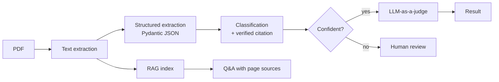

🇬🇧 English | [🇫🇷 Français](README.fr.md)

# DocAgent – AI agent for reliable PDF document analysis

DocAgent reads a PDF document, extracts its key information as structured JSON, classifies it, and answers questions about it — with a strong focus on **reliability**: every classification is backed by a verified citation, uncertain documents are sent to human review, and a second LLM grades the extraction.

Built with **LangGraph** (orchestration), **FastAPI** (REST API), **Streamlit** (demo) and **Docker**.


---

## ✨ Features

1. **Structured extraction**
   Title, document type, dates, people, key points and summary, returned as **JSON validated with Pydantic**. If the LLM output is invalid, a correction loop asks the model to fix it.

2. **Explained classification**
   The document type is chosen from a closed list, together with a confidentiality level (public, internal, confidential). The model must quote the passage that justifies its choice, and **the code checks that this quote really exists in the source text** to guard against hallucinations.

3. **Human in the loop**
   A document is flagged for human review when confidence is low, when the citation is not found in the text, or when the type is unknown.

4. **Question answering (RAG)**
   Chunking, local multilingual embeddings and cosine similarity search; answers cite the source pages.

5. **LLM-as-a-judge**
   A second model, different from the first one, scores the extraction on fidelity, completeness and absence of hallucination.

6. **API, demo and Docker**
   REST API with interactive docs at `/docs`, a Streamlit interface, and a one-command Docker setup.

---

## 🧭 How it works



The steps are orchestrated as a **LangGraph** graph.

---

## 🛠️ Technical choices

| Component | Choice |
|---|---|
| Orchestration | LangGraph |
| Agent LLM | `gpt-oss-120b` (hosted on Groq) |
| Judge LLM | `gpt-oss-20b` (hosted on Groq) — a different model from the agent |
| Typed outputs | Pydantic |
| Embeddings | `paraphrase-multilingual-MiniLM-L12-v2` (local, multilingual) |
| Retrieval | NumPy cosine similarity |
| Serving | FastAPI + Streamlit |
| Packaging | Docker / Docker Compose |
| Configuration | Environment variables — API keys never stored in the code or the image |

---

## 🚀 Getting started

```bash
pip install -r requirements.txt
cp .env.example .env        # then add your Groq API key in .env
```

**Streamlit demo**
```bash
streamlit run app.py
```

**REST API** (docs at http://localhost:8000/docs)
```bash
uvicorn api:app --reload
```

**Command line**
```bash
python main.py my_document.pdf     # analyse a document
python ask.py my_document.pdf      # ask questions about it
```

**Docker**
```bash
docker compose up --build
```

---

## 🔭 Next steps

- OCR for scanned PDFs
- SQLite storage instead of in-memory storage
- An annotated test set to compare the judge's scores with human judgment
- A vector database (FAISS or Chroma) for multi-document queries

---

## 👩‍💻 Author

**Sara Hadidi** – Master 2 in Natural Language Processing, Sorbonne Université
