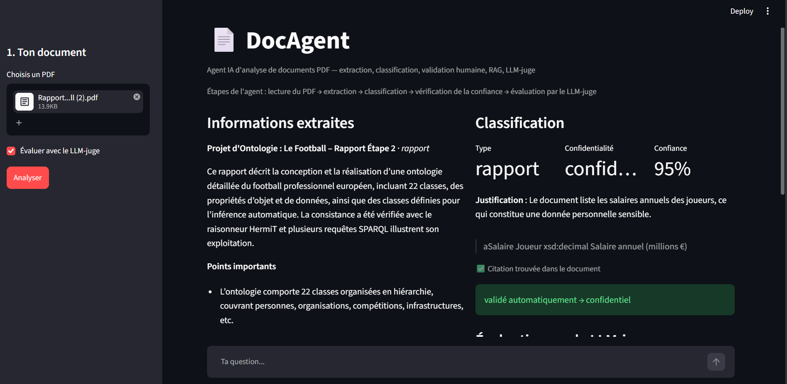
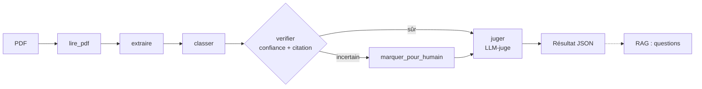

# 📄 DocAgent

**Agent IA qui analyse des documents PDF** : il extrait les informations clés en JSON structuré, classe le document (type + niveau de confidentialité) en citant le passage qui justifie sa décision, demande l'avis d'un humain quand il n'est pas sûr, répond aux questions sur le document (RAG) et fait évaluer son propre travail par un second LLM (*LLM as a judge*).

Le tout est orchestré avec **LangGraph**, exposé via une **API FastAPI**, présenté dans une **démo Streamlit** et conteneurisé avec **Docker**.



## ✨ Fonctionnalités

| | Fonctionnalité | Détail |
|---|---|---|
| 1 | **Extraction structurée** | Titre, type, dates, personnes, points importants, résumé → JSON validé par **Pydantic** (avec boucle de correction si le JSON est invalide) |
| 2 | **Classification expliquée** | Type (liste fermée) + confidentialité *public / interne / confidentiel*, avec une **citation exacte du document** — le code vérifie que la citation existe vraiment (anti-hallucination) |
| 3 | **Human in the loop** | Si la confiance est sous le seuil, si la citation est introuvable ou si le type est inconnu → le document est mis de côté pour qu'un humain valide ou corrige |
| 4 | **RAG** | Questions-réponses sur le document : découpage en chunks, embeddings multilingues, recherche par similarité cosinus, réponse avec **pages sources** — le modèle dit quand l'information n'est pas dans le document |
| 5 | **LLM as a judge** | Un **second modèle**, différent du premier, note l'extraction (fidélité, complétude, absence d'hallucination) et liste les erreurs repérées |
| 6 | **API + démo + Docker** | API REST FastAPI (doc interactive sur `/docs`), interface Streamlit, `docker compose up` pour tout lancer |

## 🧠 Architecture de l'agent (LangGraph)



```
docagent/
├── src/
│   ├── agent.py        # graphe LangGraph (enchaînement des étapes + décision)
│   ├── llm.py          # appel au LLM + validation Pydantic + boucle de correction
│   ├── schemas.py      # schémas Pydantic (extraction, classification)
│   ├── pdf_reader.py   # lecture du PDF (pypdf)
│   ├── extractor.py    # 1. extraction
│   ├── classifier.py   # 2. classification + vérification de la citation
│   ├── validation.py   # 3. seuil de confiance + décision humaine
│   ├── rag.py          # 4. RAG (embeddings + recherche + réponse)
│   └── judge.py        # 5. LLM as a judge
├── main.py             # analyse en ligne de commande
├── ask.py              # questions en ligne de commande
├── api.py              # API FastAPI
├── app.py              # démo Streamlit
├── Dockerfile
└── docker-compose.yml
```

## 🚀 Installation

```bash
git clone https://github.com/had98idi-tech/docagent.git
cd docagent
python -m venv venv && source venv/bin/activate   # Windows : venv\Scripts\activate
pip install -r requirements.txt
cp .env.example .env   # puis mettre ta clé Groq (gratuite sur console.groq.com)
```

## ▶️ Utilisation

**Démo Streamlit** (le plus visuel)
```bash
streamlit run app.py
```

**API FastAPI** → ouvrir http://localhost:8000/docs pour tester
```bash
uvicorn api:app --reload
```

| Méthode | Route | Rôle |
|---|---|---|
| `POST` | `/documents` | Envoyer un PDF → analyse complète + `doc_id` |
| `GET` | `/documents/{doc_id}` | Revoir le résultat |
| `POST` | `/documents/{doc_id}/questions` | Poser une question (RAG) |
| `POST` | `/documents/{doc_id}/validation` | Validation humaine du niveau de confidentialité |

**Ligne de commande**
```bash
python main.py data/mon_doc.pdf              # analyse complète
python main.py data/mon_doc.pdf --sans-juge  # plus rapide
python ask.py data/mon_doc.pdf               # poser des questions
```

**Docker** (API + démo en une commande)
```bash
docker compose up --build
# démo : http://localhost:8501   ·   API : http://localhost:8000/docs
```

## 📋 Exemple de résultat (extrait)

```json
{
  "classification": {
    "type_document": "cours",
    "confidentialite": "public",
    "justification": "Exposé académique, sans données personnelles ou sensibles.",
    "citation": "Saint-Malo est une ville portuaire de Bretagne, au nord-ouest de la France.",
    "confiance": 0.97,
    "citation_verifiee": true
  },
  "validation": { "statut": "validé automatiquement", "confidentialite_finale": "public" },
  "evaluation": { "fidelite": 5, "completude": 4, "absence_hallucination": 5, "score_global": 4.67 }
}
```

## 🛠️ Choix techniques

- **Groq** (modèles `gpt-oss-120b` pour l'agent, `gpt-oss-20b` pour le juge) : API gratuite et rapide ; les modèles se changent dans le `.env` sans toucher au code.
- **Pydantic** : sorties du LLM typées et validées ; listes fermées (`Literal`) pour la classification.
- **Vérification de la citation par le code** : une justification n'est pas juste « crue », elle est contrôlée dans le texte source.
- **Juge ≠ modèle évalué** : évite qu'un modèle se note lui-même.
- **Embeddings locaux** (`paraphrase-multilingual-MiniLM-L12-v2`) : gratuits, multilingues, sans base vectorielle (produit scalaire NumPy, suffisant pour un document).
- **Configuration** par variables d'environnement (`.env`) : la clé API n'est jamais dans le code ni dans l'image Docker.

## 🔭 Pistes d'amélioration

- OCR pour les PDF scannés
- Base de données (SQLite) au lieu du stockage en mémoire de l'API
- Jeu de test annoté pour comparer les notes du LLM-juge à un jugement humain
- Base vectorielle (FAISS, Chroma) pour interroger plusieurs documents à la fois

## 👩‍💻 Autrice

**Sara Hadidi** — Master 2 Langue et Informatique – Traitement Automatique des Langues (NLP), Sorbonne Université
GitHub : [had98idi-tech](https://github.com/had98idi-tech)
